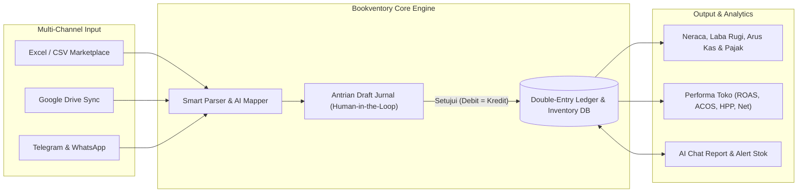

# Bookventory — AI-Powered Double-Entry Accounting, Tax & Inventory Engine

**Bookventory** adalah platform pembukuan otomatis (*Double-Entry Accounting*), kalkulasi HPP (*Perpetual Weighted Average & BOM Formula*), serta pelaporan pajak (PPh 22 Marketplace, PPN, PPh Final) yang terintegrasi dengan **AI Assistant**, **Google Drive**, dan **Media Chat (Telegram & WhatsApp)**.

Dirancang khusus untuk penjual multi-channel (Shopee, TikTok Shop, Tokopedia, dan POS/Excel Custom) agar setiap rupiah penjualan, biaya admin, iklan, HPP, hingga selisih Rp 1 sekalipun tercatat secara otomatis dan seimbang (`Debit = Kredit`).

---

## Daftar Dokumentasi

1. [**Arsitektur, Bedah Fitur & Pilihan Tech Stack**](./docs/01-architecture-and-tech-stack.md)
   * Prinsip desain *Deterministic Accounting + AI Orchestration*
   * Bedah 6 modul utama (Smart Import, Antrian Draft Jurnal, Stok & BOM, AI Chat, Laporan Keuangan, Performa Toko)
   * Perbandingan & opsi *tech stack* (Frontend, Backend, Database, Parser, AI Model, Chat Webhook)
2. [**Work Plan & Step-by-Step Implementation**](./docs/02-work-plan-and-steps.md)
   * Tahapan eksekusi teknis *end-to-end* (Fase 1 s/d Fase 4)
   * Skema database & Chart of Accounts (COA) standar
   * Checklist deliverable per minggu/milestone
3. [**Estimasi Biaya Infrastruktur, API & Operasional (Cost Breakdown)**](./docs/03-cost-estimation.md)
   * Setup khusus Anda (VPS sendiri + OpenClaw/Hermes + Gemini Pro = **Rp 0 biaya tambahan/bln**)
   * Simulasi biaya bulanan untuk **Skala MVP / Bootstrap**, **Production Single-Company**, dan **SaaS Multi-Tenant**
4. [**Panduan Preview via Docker & Instalasi VPS (Bookventory + OpenClaw / Hermes + Gemini)**](./docs/04-installation-and-setup-guide.md)
   * **Bagian A:** Petunjuk *Quick Build & Preview* langsung menggunakan Docker (`docker compose up --build -d`) sejak Fase 1
   * **Bagian B:** Langkah instalasi Production di VPS Ubuntu + pairing WhatsApp (QR Scan) & Telegram Bot menggunakan **OpenClaw** (`openclaw`) atau **Hermes Agent** (`hermes`) dengan model **Gemini 2.5 Pro/Flash**

---

## Quick Preview via Docker (Begitu Fase 1 Selesai)

Setiap milestone selesai di-push ke repository ini, Anda dapat langsung mem-build dan mencoba preview website beserta database PostgreSQL & data simulasi (COA + transaksi contoh) melalui Docker:

```bash
git clone https://github.com/fransiscuspandhu/bookventory.git
cd bookventory
git pull origin main

# Build & jalankan aplikasi + database PostgreSQL
docker compose up --build -d

# Buka di browser: http://localhost:3000
```

---

## Ringkasan Cepat (Quick Overview)


