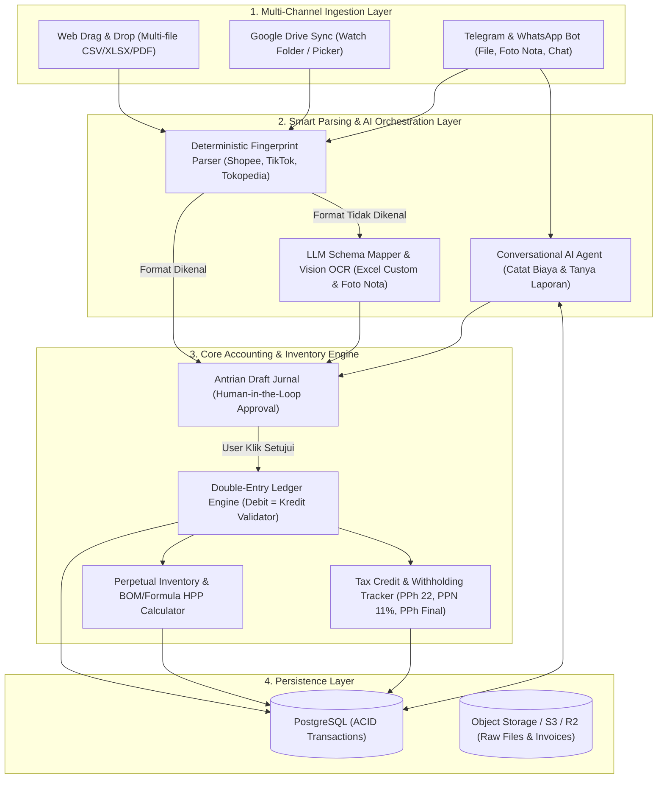

# 1. Arsitektur, Bedah Fitur & Pilihan Tech Stack

Dokumen ini menjabarkan spesifikasi arsitektur untuk **Bookventory**: sistem pembukuan otomatis, HPP, dan pajak berbasis AI dengan kapabilitas multi-channel (Web, Google Drive, Telegram, dan WhatsApp).

---

## 1. Prinsip Arsitektur Utama

> [!IMPORTANT]
> **Jangan Biarkan LLM Menghitung Angka Akuntansi Secara Langsung.**
> LLM sangat baik dalam memahami konteks, membaca nota, memetakan kolom Excel yang tidak standar, dan menerjemahkan bahasa manusia ke instruksi terstruktur (*Tool Calling / Text-to-SQL*). Namun, seluruh perhitungan uang, HPP (*Weighted Average*), pajak (PPh 22 / PPN), dan keseimbangan jurnal (`SUM(Debit) == SUM(Kredit)`) **wajib dieksekusi oleh Deterministic Accounting Engine** menggunakan tipe data presisi tinggi (`DECIMAL(18,2)` / `BigInt`).

---

## 2. Bedah 6 Modul Inti (Berdasarkan Referensi Sistem)

### Modul 1: Smart Multi-File Import (`/import`)
* **Deteksi Sidik Jari Toko & Jenis File:**
  * User dapat mengunggah banyak file sekaligus (`.csv` / `.xlsx`), boleh campur toko dan platform (misal: `All_order_TikTok.csv`, `Income.sudah_dilepas.Shopee.xlsx`, `Order.all.Shopee.xlsx`).
  * Indikator visual baris pratinjau:
    * **Hijau (Dikenali):** Toko dan jenis laporan terdeteksi otomatis dari *fingerprint* file.
    * **Kuning (Tidak Dikenali):** User memilih toko dan mencentang konfirmasi; sistem mempelajari *fingerprint* toko tersebut untuk upload berikutnya.
    * **Merah (Konflik):** Ada bukti menunjuk ke toko lain; ditolak untuk mencegah salah buku.
* **Privasi & Sanitasi Data:** Nama, nomor HP, dan alamat pembeli otomatis diabaikan (tidak disimpan ke database keuangan).
* **Validasi SKU & Pemisahan Data:** Memisahkan jumlah pesanan (*Order*), pencairan dana (*Settlement/Penyesuaian*), dan *Mutasi Saldo*, serta fitur **"Cek Ulang SKU"** untuk memastikan setiap SKU di marketplace terhubung ke master barang jadi di gudang.

### Modul 2: Generator Draft Jurnal & Antrian Persetujuan (`/antrian`)
Setiap data masuk (baik dari import file marketplace, mutasi iklan, transaksi stok, maupun chat AI) **tidak langsung mengubah laporan keuangan**, melainkan masuk sebagai **Draft Jurnal** di halaman Antrian:
* **Struktur Draft Jurnal Settlement Marketplace (Satu Draft per Toko per Tanggal Cair):**
  * `Kredit` **4112 - Penjualan Marketplace** (Omzet penjualan bruto)
  * `Debit` **4201 - Retur Penjualan** (Jika ada retur di batch settlement tersebut)
  * `Debit` **5203 - Beban Fee & Promo Marketplace** (Biaya admin, komisi, biaya layanan)
  * `Debit` **1218 - PPh 22 Dibayar Dimuka** (Pajak yang dipotong otomatis oleh marketplace — tercatat rapi sebagai kredit pajak)
  * `Debit` **1209 - Saldo Iklan Dibayar Dimuka** (Jika ada potongan saldo iklan)
  * `Debit` **1106 / 1109 - Saldo Penjual (TikTok / Shopee)** (Dana bersih yang cair ke saldo wallet toko)
  * `Debit` **5101 - HPP Barang Jadi** & `Kredit` **1206 - Persediaan Barang Jadi** (Dihitung otomatis dari kuantitas SKU terjual × HPP rata-rata tertimbang saat itu)
* **Jurnal Selisih Settlement (Presisi hingga Rp 1):**
  * Jika ada selisih pembulatan atau penyesuaian Rp 1 – Rp 4 antara pesanan dan settlement, sistem otomatis membuat draft jurnal penyesuaian tersendiri agar Neraca 100% seimbang.
* **Jurnal Iklan & Utang Iklan (Contoh: TikTok GMV Max):**
  * Mencatat `Debit: 5308 - Beban Iklan Marketplace` (termasuk PPN 11%) dan `Kredit: 2112 - Utang Iklan TikTok (GMV Pay)` beserta selisih yang belum ditagih.

### Modul 3: Stok Gudang, BOM Formula, & HPP Otomatis (`/stok-gudang`)
* **3 Sub-Menu Utama:** `Saldo`, `Formula (Resep/BOM)`, dan `Produk`.
* **Perhitungan Modal Per Produk Otomatis:**
  * Saat mencatat pembelian Bahan Baku (`1213`) atau Kemasan (`1214`), ongkir/biaya lain otomatis dialokasikan secara proporsional ke harga barang.
  * Mendukung pencatatan: `Pembelian`, `Produksi` (mengonversi bahan baku + kemasan menjadi barang jadi sesuai Formula), `Rusak`, `Retur`, `Stock Opname`, dan `Sampel`.
* **Peringatan Stok Kritis (Run-Rate & Bottleneck Predictor):**
  * Menghitung kecepatan penjualan harian (misal `44,1 botol/hari`) terhadap sisa stok fisik dan *lead time* pemasok.
  * Memberikan alert spesifik komponen penghambat: *"JHM ±3 hari Kritis — Terhambat SRB-JHM (-37 botol), pesan sekarang ±31,6 kg"*.

### Modul 4: Asisten AI Multi-Channel (Web Chat, Telegram, WhatsApp)
* **Input Transaksi via Bahasa Natural:**
  * Contoh chat: *"bayar iklan Meta satu juta lima ratus"* atau *"Gaji 2 staff gudang 7.600.000"*.
  * AI menerjemahkan kalimat tersebut menjadi draft jurnal: `Debit: 5301 - By Pemasaran META ADS Rp1.500.000`, `Kredit: 1102 - BCA PT Rp1.500.000`, lalu memunculkan tombol **"Tinjau draft di Antrian"**.
* **Upload File & Foto Nota via Chat (Telegram / WhatsApp):**
  * User kirim file `.xlsx` / `.csv` atau foto struk belanja ke nomor bot WhatsApp/Telegram -> Bot memproses file -> Mengirim ringkasan draft jurnal ke chat beserta tombol *Approve*.
* **Query Laporan via Chat:**
  * User bisa bertanya via WA/Telegram: *"Berapa laba bersih bulan November?"*, *"Toko mana yang ROAS-nya paling bagus minggu ini?"*, atau *"Berapa total potongan pajak PPh 22 bulan ini?"*.

### Modul 5: Laporan Keuangan Standar Akuntansi (`/laporan`)
* **Neraca (Balance Sheet):** Menampilkan Aktiva (Kas & Bank, Piutang/Dana di Marketplace, Persediaan Barang Jadi/Bahan Baku/Kemasan, PPh 22 Dibayar Dimuka, Aset Tetap) dan Pasiva & Modal (Utang Iklan GMV Pay, Modal Disetor, Laba/Rugi Periode Berjalan). Dilengkapi indikator **"Status Neraca: Seimbang (Aset = Liabilitas + Ekuitas)"**.
* **Laba Rugi (Income Statement):** Pendapatan bersih (setelah retur), Laba Kotor (setelah HPP), Beban Operasional/Iklan/Fee, dan Laba Bersih (menampilkan saldo Awal, Berjalan, Akhir).
* **Arus Kas (Cash Flow):** Saldo awal, Arus kas Operasi, Investasi, Pendanaan, dan Saldo akhir.
* **Buku Besar (General Ledger) & Ekspor Excel/PDF:** Siap dibawa ke akuntan atau konsultan pajak.

### Modul 6: Performa Toko, Cek KPI, & Forecast (`/performa-toko` & `/laporan`)
* **Performa Toko (Pemisahan Tanggal Order vs Tanggal Cair):**
  * *Berdasarkan Tanggal Order:* Jumlah Order, Omzet Order, Batal, Iklan, **ROAS** (misal `12,89x`), **ACOS** (`7,8%`), Utang iklan belum ditagih.
  * *Berdasarkan Tanggal Cair (Settlement):* Penjualan cair, **AOV** (Average Order Value), **Net/order**, **% Net**, **AOP**, **Fee %** (`12,1%`), **HPP**, dan **Laba Kontribusi** per toko.
* **Cek KPI & Simulasi Forecast:**
  * Indikator kesehatan rasio Neraca & Laba Rugi (`Hijau = sesuai`, `Kuning = waspada`, `Merah = perlu dibenahi`).
  * Kalkulator proyeksi 1–3 bulan ke depan (Skenario Rendah/Normal/Tinggi) berdasarkan *Budget Iklan per 30 hari* dan *Biaya Tetap*, lengkap dengan proyeksi kebutuhan pembelian bahan baku (dalam kg/pcs).

---

## 3. Perbandingan & Opsi Tech Stack

Berikut adalah matriks pilihan teknologi beserta rekomendasi utama:

| Layer | Opsi A (Recommended - Modern Fullstack TS) | Opsi B (Hybrid TS + Python Data Engine) | Opsi C (Enterprise Go + React) |
| :--- | :--- | :--- | :--- |
| **Frontend & UI** | **Next.js 15 (App Router) + Tailwind CSS + Shadcn UI** | Next.js + Tailwind + Shadcn UI | React (Vite) + Tailwind + Shadcn UI |
| **Backend / API** | **Next.js Route Handlers & Server Actions (TypeScript)** | **Python FastAPI** (Data/Accounting) + Next.js | **Golang (Fiber / Echo)** |
| **Database & ORM** | **PostgreSQL + Prisma ORM / Drizzle ORM** | PostgreSQL + SQLModel / SQLAlchemy | PostgreSQL + sqlc / GORM |
| **Decimal Precision** | `decimal.js` + Postgres `NUMERIC(18,2)` | Python `Decimal` + Postgres `NUMERIC(18,2)` | `shopspring/decimal` + Postgres `NUMERIC` |
| **Excel/CSV Parser** | **SheetJS (`xlsx`) / `ExcelJS` + `PapaParse`** | **`Polars` / `Pandas` + `openpyxl`** | `excelize` + `encoding/csv` |
| **AI SDK & LLM** | **Google Gemini 2.5 Pro / Flash** (via Gemini API / OAuth CLI) | **PydanticAI / LangChain** (Gemini 2.5 Pro / Flash) | Official Gemini Go SDK |
| **Background Queue** | **Inngest** atau **BullMQ (Redis)** | **Celery / ARQ (Redis)** | **Asynq (Redis)** |
| **Chat & Agent Gateway** | **OpenClaw** atau **Hermes Agent** (Self-hosted di VPS: Native WA & Telegram) | **Hermes Agent** (Python native) / **OpenClaw** | Custom Webhook + WAHA |
| **Alternative Direct Bot** | `grammY` (Telegram) + `Baileys/WAHA` (WhatsApp) | `aiogram` + `WAHA` | `telebot` + `whatsmeow` |

### Kenapa Opsi A (Fullstack Next.js TypeScript + PostgreSQL + OpenClaw / Hermes) Sangat Direkomendasikan?
1. **Satu Codebase & End-to-End Type Safety:** Skema database (Drizzle/Prisma), validasi form & AI Structured Output (`Zod`), hingga komponen UI React berbagi tipe data yang sama.
2. **UI/UX Setara Video Referensi:** Tampilan di video referensi menggunakan pola desain *mobile-first card & tab layout* yang sangat identik dengan ekosistem **Tailwind CSS + Shadcn UI**.
3. **Zero-Cost Chat Gateway via OpenClaw / Hermes Agent di VPS Sendiri:**
   * **OpenClaw** maupun **Hermes Agent (Nous Research)** sudah memiliki *built-in messaging gateway* untuk **WhatsApp (via Baileys QR Pairing)** dan **Telegram (via Bot Token)**, plus dukungan kirim/terima file Excel, gambar nota, dan *voice note*.
   * Kita cukup membuat **Bookventory Skill / MCP Server / REST Tool** yang dipanggil oleh OpenClaw atau Hermes setiap kali user mengirim file laporan atau bertanya di chat!
4. **Optimalisasi Langganan Gemini Pro:**
   * OpenClaw dan Hermes mendukung autentikasi model Google Gemini. Untuk penggunaan personal/internal di VPS bersama OpenClaw/Hermes, Anda dapat memanfaatkan ekosistem Gemini (baik via Google AI Studio Free/Pay-as-you-go Tier maupun integrasi Gemini CLI/OAuth pada agent).
