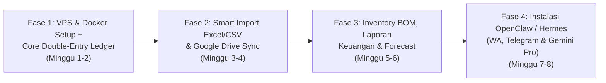

# 2. Work Plan & Step-by-Step Implementation Guide

Dokumen ini berisi rencana kerja teknis (*step-by-step*) untuk membangun **Bookventory** dari nol hingga siap digunakan di *production*.

---

## Ringkasan Timeline, Milestone & Posisi Instalasi VPS / OpenClaw / Hermes

### Peta Posisi Instalasi per Fase (Masuk ke Fase Berapa?)

Detail teknis perintah instalasi terdapat di [**docs/04-installation-and-setup-guide.md**](./04-installation-and-setup-guide.md), dan dieksekusi pada fase berikut:

| Komponen Instalasi | Masuk ke Fase | Detail Langkah di Work Plan |
| :--- | :--- | :--- |
| **1. Setup VPS, Docker, PostgreSQL & Next.js App** | **Fase 1** (`Step 1.1 & 1.2`) | Instalasi Docker Compose, database PostgreSQL, migrasi tabel, & *seeding* Chart of Accounts (COA) di VPS. |
| **2. Setup File Storage & Google Drive API** | **Fase 2** (`Step 2.4`) | Konfigurasi folder upload Excel/CSV & kredensial Google Drive Watch Folder di `.env` VPS. |
| **3. Instalasi OpenClaw / Hermes Agent + Gemini Pro** | **Fase 4** (`Step 4.2`) *(Bisa juga dimajukan ke akhir Fase 2 jika ingin tes upload Excel via WA/Telegram lebih awal)* | Instalasi CLI `openclaw` atau `hermes-agent` di VPS, login model **Gemini 2.5 Pro/Flash**, scan QR WhatsApp, input token BotFather Telegram, dan pasang `bookventory-skill`. |

---

## Fase 1: Foundation, VPS Setup, Database Schema & Double-Entry Engine (Minggu 1–2)

Tujuan Fase 1 adalah menyiapkan environment VPS (Docker + PostgreSQL) serta membangun fondasi akuntansi *double-entry* yang presisi (`Debit = Kredit`), Chart of Accounts (COA), halaman **Antrian Draft Jurnal**, dan **Dashboard Ringkasan**.

### Step 1.1: VPS Environment, Docker Compose & Project Scaffolding
- [ ] **Setup VPS & Docker (Tahap 1 & 2 di [Panduan Instalasi](./04-installation-and-setup-guide.md)):**
  - Install Docker, Docker Compose, dan Node.js 22 LTS (`pnpm`) di VPS Ubuntu.
  - Buat `docker-compose.yml` untuk menjalankan container `postgres:16-alpine` dan aplikasi `bookventory-web`.
- [ ] Inisialisasi project **Next.js (App Router, TypeScript)** dengan **Tailwind CSS** dan **Shadcn UI**.
- [ ] Konfigurasi `decimal.js` untuk seluruh operasi aritmatika keuangan di sisi aplikasi.
- [ ] Membangun *App Shell* & Navigasi responsif (Mobile & Desktop) dengan tema warna hijau zamrud (*emerald green*) bersih sesuai referensi:
  - Topbar: Drawer Menu, Judul Halaman, Quick Search, Tombol `+` (Quick Action), Notifikasi.
  - Halaman utama: `Dashboard`, `Import`, `Antrian`, `Stok Gudang`, `Laporan`, `Performa Toko`, `Asisten AI`.

### Step 1.2: Desain Database PostgreSQL & Chart of Accounts (COA)
- [ ] Setup PostgreSQL + Prisma/Drizzle ORM dengan skema tabel inti:
  1. `stores`: Menyimpan daftar toko (misal: `Topherbal Official - TikTok`, `topherbal.id - Shopee`), platform, dan *fingerprint rules*.
  2. `accounts`: Menyimpan Chart of Accounts (COA) standar:
     - **11xx Kas & Bank / Wallet:** `1102 - BCA PT`, `1106 - Saldo Penjual TikTok`, `1109/1111 - Saldo Penjual Shopee`.
     - **12xx Piutang, Persediaan & Dibayar di Muka:** `1206 - Persediaan Barang Jadi`, `1209 - Saldo Iklan Dibayar Dimuka`, `1213 - Persediaan Bahan Baku`, `1214 - Persediaan Kemasan`, `1217 - Perlengkapan`, `1218 - PPh 22 Dibayar Dimuka`.
     - **13xx Aset Tetap:** `1301 - Peralatan`.
     - **21xx Liabilitas Jangka Pendek:** `2112 - Utang Iklan TikTok (GMV Pay)`, `2115 - Utang Usaha`.
     - **31xx Ekuitas / Modal:** `3101 - Modal Disetor`, `3104 - Laba/Rugi Periode Berjalan`.
     - **41xx–42xx Pendapatan:** `4112 - Penjualan Marketplace`, `4201 - Retur Penjualan`.
     - **51xx–58xx HPP & Beban:** `5101 - HPP Barang Jadi`, `5203 - Beban Fee & Promo Marketplace`, `5301 - Pemasaran Meta Ads`, `5308 - Beban Iklan Marketplace`, `5401 - Beban Gaji Karyawan`, `5803 - Pendapatan Lain: Kompensasi Marketplace`.
  3. `journal_entries`: Header jurnal (`id`, `store_id`, `entry_date`, `source_type` [`MARKETPLACE`, `STOK`, `IKLAN`, `AI`], `status` [`DRAFT`, `APPROVED`, `REJECTED`], `title`, `reference_hash`, `total_amount`).
  4. `journal_lines`: Baris debit/kredit (`journal_entry_id`, `account_id`, `debit`, `credit`, `memo`).

### Step 1.3: Core Double-Entry Validator & Approval Queue (`/antrian`)
- [ ] Buat service `JournalEngine.createDraft()` dan `JournalEngine.approveDraft()`.
- [ ] **Aturan Validasi Ketat:** Sebuah draft jurnal hanya bisa di-approve jika `SUM(debit) === SUM(credit)` dan nilainya `> 0`.
- [ ] Bangun UI `/antrian`:
  - Kartu status: `Menunggu (N)`, `Bermasalah (0)`, `Disetujui hari ini (N)`.
  - Kartu Draft Jurnal lengkap dengan badge `Menunggu`, `Marketplace / Stok / Iklan / AI`, tanggal, rincian baris `Debit` (hijau) dan `Kredit` (abu/merah), serta tombol **`✓ Setujui`**, **`Edit`**, dan **`✕ Tolak`**.

---

## Fase 2: Smart Import Engine & Marketplace Parser (Minggu 3–4)

Tujuan Fase 2 adalah mengotomatiskan pembacaan file laporan Excel/CSV dari Shopee, TikTok Shop, Tokopedia, maupun Excel custom/Google Drive menjadi Draft Jurnal.

### Step 2.1: Multi-File Upload & Store Fingerprint Detector (`/import`)
- [ ] Buat komponen Drag & Drop multi-file (`.csv`, `.xlsx`) di `/import`.
- [ ] Bangun **File Fingerprint Engine**:
  - Membaca struktur header dan metadata file untuk mendeteksi jenis laporan:
    - TikTok Shop: `All_order_*.csv`, `Income_*.xlsx` (Settlement/Withdraw).
    - Shopee: `Order.all.*.xlsx`, `Income.sudah_dilepas.*.xlsx`.
  - Mendeteksi identitas toko dari pola nama file atau isi kolom SKU/Order ID.
  - Menampilkan tabel **Pratinjau deteksi toko** dengan status warna (Hijau = dikenali, Kuning = pilih toko & pelajari sidik jari, Merah = konflik).
- [ ] Sanitasi PII otomatis: Drop kolom Nama Pembeli, No HP, dan Alamat Pengiriman saat parsing berlangsung.

### Step 2.2: Settlement-to-Journal Generator (Otomatisasi HPP & PPh 22)
- [ ] Buat algoritma agregasi **Satu Draft Jurnal per Toko per Tanggal Cair (Settlement Date)**:
  - Menghitung total Harga Jual Bruto -> `Kredit 4112`.
  - Menghitung total Retur -> `Debit 4201`.
  - Menghitung total Biaya Admin, Komisi, Layanan -> `Debit 5203`.
  - Mengekstrak **PPh 22 yang dipotong Marketplace** -> `Debit 1218 (PPh 22 Dibayar Dimuka)`.
  - Mengekstrak potongan saldo iklan / kompensasi -> `Debit 1209` / `Kredit 5803`.
  - Menghitung dana bersih yang masuk ke saldo marketplace -> `Debit 1106 / 1109`.
  - Menghitung total kuantitas SKU terjual di settlement tersebut × HPP Produk -> `Debit 5101 (HPP)` & `Kredit 1206 (Persediaan Barang Jadi)`.
- [ ] **Deteksi Selisih Rp 1 & Rekonsiliasi Iklan (GMV Max):**
  - Jika ada selisih pembulatan antara order dan settlement (walau hanya Rp 1 – Rp 4), buat draft jurnal `Selisih Settlement` secara otomatis.

### Step 2.3: AI Fallback Parser (Untuk Excel Custom & Format Baru)
- [ ] Jika user mengunggah file Excel penjualan custom (di luar format standar Shopee/TikTok), kirim 15 baris pertama ke **Gemini 2.5 Pro / Flash** menggunakan *Structured Output* untuk memetakan kolom secara dinamis ke struktur jurnal.

### Step 2.4: Integrasi Google Drive Sync
- [ ] Integrasi **Google Drive API** (OAuth2 / Service Account).
- [ ] Tambahkan tombol **"Ambil dari Google Drive"** atau **Watch Folder**: setiap ada file `.xlsx`/`.csv` baru di folder Google Drive yang ditunjuk, sistem otomatis menariknya ke halaman `/import`.

---

## Fase 3: Stok Gudang (BOM/Formula), Laporan Keuangan & Forecast (Minggu 5–6)

Tujuan Fase 3 adalah memastikan nilai HPP dan Persediaan di Neraca selalu akurat secara *perpetual*, serta menyajikan laporan keuangan dan analisis *unit economics* per toko.

### Step 3.1: Modul Stok Gudang & Formula BOM (`/stok-gudang`)
- [ ] Buat tabel `products` (tipe: `FINISHED_GOOD`, `RAW_MATERIAL`, `PACKAGING`), `product_formulas` (resep komposisi bahan baku & kemasan per 1 unit barang jadi), dan `inventory_transactions`.
- [ ] Implementasi form **Transaksi Stok**:
  - **Pembelian:** Input nota pembelian beberapa barang + ongkir. Sistem otomatis membagi ongkir secara proporsional ke harga pokok barang (*Weighted Average Cost*) dan membuat draft jurnal (`Debit: Persediaan`, `Kredit: Kas/Bank atau Utang`).
  - **Produksi:** Mengurangi stok Bahan Baku (`1213`) & Kemasan (`1214`) sesuai Formula dan menambah stok Barang Jadi (`1206`) beserta akumulasi HPP-nya.
  - **Rusak, Retur, Stock Opname, Sampel.**
- [ ] Implementasi **Smart Reorder Alert (Peringatan Stok)**:
  - Hitung *daily burn rate* (rata-rata penjualan harian 14–30 hari terakhir).
  - Tampilkan peringatan item kritis (`±N hari Kritis`), identifikasi bahan baku pembatas (*bottleneck*), dan rekomendasi jumlah pesanan (`pesan sekarang ±X kg / pcs`).

### Step 3.2: Laporan Keuangan Otomatis (`/laporan`)
- [ ] **Tab Neraca:** Agregasi saldo akun Aktiva vs Pasiva & Modal (Saldo Awal, Mutasi Berjalan, Saldo Akhir) + validator **`Seimbang ✓ (Aset = Liabilitas + Ekuitas)`**.
- [ ] **Tab Laba Rugi:** Pendapatan bersih, Laba Kotor (setelah HPP), Beban di luar HPP, Laba Bersih.
- [ ] **Tab Arus Kas:** Metode langsung/tidak langsung (Operasi, Investasi, Pendanaan, Saldo Awal & Akhir).
- [ ] **Tab Buku Besar & Ekspor:** Rincian mutasi per kode akun & ekspor ke Excel/PDF.

### Step 3.3: Performa Toko, Cek KPI & Forecast (`/performa-toko` & `/laporan`)
- [ ] **Halaman Performa Toko:**
  - Metrik *Tanggal Order* (Order, Omzet Order, Batal, Iklan, ROAS, ACOS, Utang iklan belum ditagih).
  - Metrik *Tanggal Cair* (Penjualan cair, AOV, Net/order, % Net, AOP, Fee %, HPP, Laba Kontribusi).
- [ ] **Tab Cek KPI:** Persentase komponen Neraca terhadap Total Aset dan komponen Laba Rugi terhadap Omzet (`41xx`) dengan indikator lampu lalu lintas (Hijau/Kuning/Merah).
- [ ] **Tab Forecast:** Kalkulator proyeksi 1/2/3 bulan ke depan dengan skenario (Rendah/Normal/Tinggi), input *Budget Iklan per 30 hari* & *Biaya Tetap*, menghasilkan proyeksi Omzet, Order, Fee Marketplace, HPP, Laba Bersih, Kas Terendah, dan Kebutuhan Stok Bahan Baku.

---

## Fase 4: AI Assistant & Instalasi OpenClaw / Hermes Agent di VPS (Minggu 7–8)

Tujuan Fase 4 adalah memungkinkan pencatatan transaksi, upload file laporan/nota, dan pengecekan laporan keuangan langsung dari ruang chat (Telegram & WhatsApp) menggunakan **OpenClaw** atau **Hermes Agent** yang di-deploy di VPS yang sama (Lihat detail perintah di [**Tahap 3 & 4 Panduan Instalasi**](./04-installation-and-setup-guide.md)).

### Step 4.1: In-App AI Assistant & Bookventory API / MCP Tools (`/asisten-ai`)
- [ ] Bangun antarmuka chat AI di web sekaligus ekspos **Bookventory Agent Tools (REST API `/api/agent/*` & MCP Server)** agar bisa dipanggil oleh In-App Chat, **OpenClaw**, maupun **Hermes Agent**:
  1. `POST /api/agent/import` (`upload_and_parse_report`): Menerima file `.xlsx` / `.csv` dari chat (Telegram/WA), menjalankan parser Fase 2, dan mengembalikan ringkasan draft jurnal.
  2. `POST /api/agent/draft-journal` (`create_expense_or_journal_draft`): Mengubah chat seperti *"bayar iklan Meta satu juta lima ratus"* atau *"gaji 2 staff gudang 7,6 juta"* menjadi draft jurnal siap setujui di `/antrian`.
  3. `POST /api/agent/parse-receipt` (`parse_receipt_image`): Membaca foto nota pembelian kemasan/bahan baku menggunakan **Gemini 2.5 Pro/Flash Vision** menjadi draft transaksi stok & jurnal.
  4. `POST /api/agent/approve` (`approve_pending_drafts`): Menyetujui draft jurnal langsung dari perintah chat.
  5. `GET /api/agent/reports/summary` (`query_financial_summary`): Menjawab pertanyaan analitik (*"Berapa laba bersih dan kredit pajak PPh 22 bulan ini?"*, *"Toko mana yang ROAS-nya tertinggi?"*) langsung dari `JournalEngine`.

### Step 4.2: Instalasi OpenClaw atau Hermes Agent di VPS (Telegram & WhatsApp)
Kita dapat memilih salah satu (atau keduanya) karena sama-sama berjalan secara *self-hosted* di VPS Anda:
- [ ] **Opsi A — Instalasi OpenClaw (`openclaw`):**
  1. `npm install -g openclaw && openclaw onboard` (Pilih model **Google Gemini 2.5 Pro/Flash**).
  2. Hubungkan Telegram: `openclaw channels add --channel telegram --token "<BOT_TOKEN>"`.
  3. Hubungkan WhatsApp (Scan QR): `openclaw plugins install @openclaw/whatsapp && openclaw channels login --channel whatsapp`.
  4. Copy `integrations/openclaw-skill` ke `~/.openclaw/skills/bookventory` dan jalankan `openclaw gateway`.
- [ ] **Opsi B — Instalasi Hermes Agent (`NousResearch/hermes-agent`):**
  1. Clone & install: `git clone https://github.com/NousResearch/hermes-agent.git ~/hermes-agent && cd ~/hermes-agent && pip install -e .`
  2. Set model ke Gemini Pro: `hermes config set model gemini/gemini-2.5-pro`.
  3. Jalankan `hermes gateway setup` (untuk Telegram) & `hermes whatsapp` (Scan QR WhatsApp).
  4. Copy `integrations/hermes-skill` ke `~/.hermes/skills/bookventory` dan jalankan `hermes gateway start`.
- [ ] **Scheduled Cron Digest (Fitur Bawaan OpenClaw / Hermes):**
  - Konfigurasi cron job di OpenClaw/Hermes setiap pukul 20:00 WIB untuk mengirim laporan otomatis ke WhatsApp/Telegram Owner (Omzet hari ini, Dana cair, Laba kontribusi, dan Peringatan Stok Kritis).
